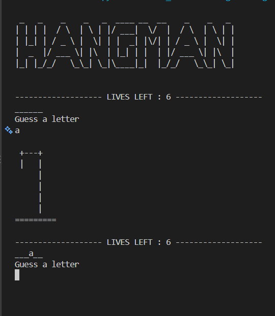
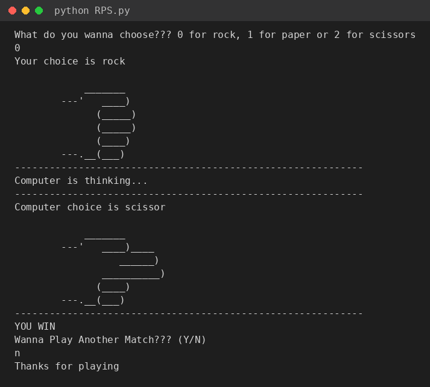
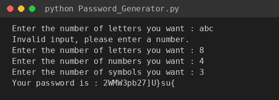
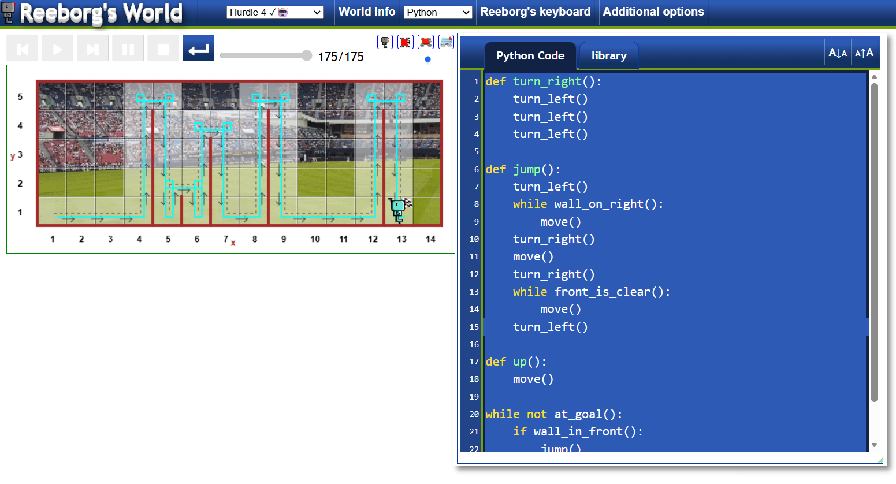
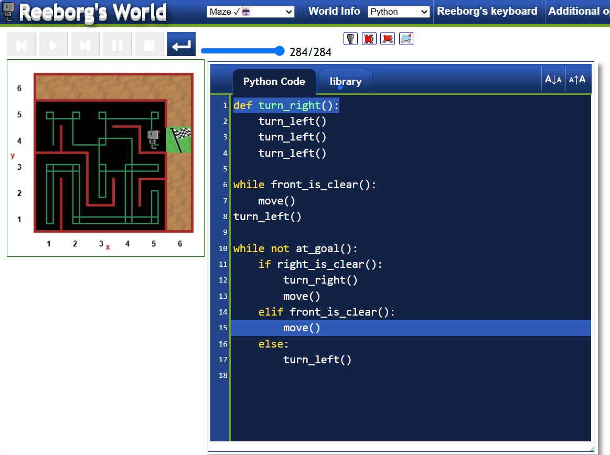

# Mini Projects

A collection of small Python projects I built while learning programming.

| Project | What it does | How to run |
|---|---|---|
| [Hangman](hangman/) | Guess the hidden word one letter at a time before the hangman is drawn. 6 lives, ASCII art, 100+ words. | `cd hangman` then `python Hangman.py` |
| [Rock Paper Scissors](rock_paper_scissors/) | Play rock, paper, scissors against the computer, with ASCII hand art and replay. | `python rock_paper_scissors/RPS.py` |
| [Password Generator](password_generator/) | Creates a random password from the number of letters, numbers and symbols you choose. Uses Python's `secrets` module for secure randomness. | `python password_generator/Password_Generator.py` |
| [Reeborg's World: Hurdle 4](reeborg_world/hurdle/) | Guides a robot over hurdles of different heights to reach the goal. | Paste the code into [Reeborg's World](https://reeborg.ca/) (link in the file) |
| [Reeborg's World: Maze](reeborg_world/maze/) | Solves any maze by following the right-hand wall. | Paste the code into [Reeborg's World](https://reeborg.ca/) (link in the file) |

## Screenshots

### Hangman

### Rock Paper Scissors

### Password Generator

### Reeborg's World: Hurdle 4

### Reeborg's World: Maze

## Requirements

- Python 3.6 or newer
- No extra libraries needed (only the standard library)
